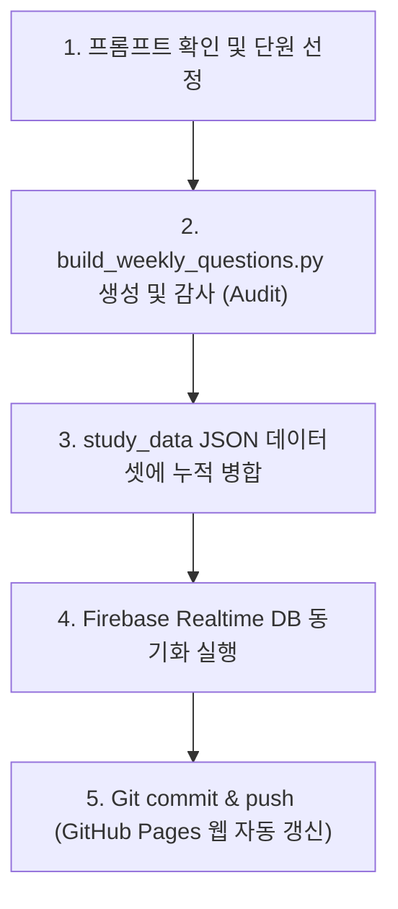

# 📘 [하루마스터] 맞춤형 주간 문제 생성 프롬프트 & 가이드라인

> **용도**: 향후 "이 프롬프트 md 파일 참고해서 이번 주 문제 생성해줘"라고 요청할 때, AI 에이전트가 완벽한 무결성으로 즉시 문제를 생성하고 파이어베이스 및 웹 호스팅에 자동 반영하도록 지시하는 표준 프롬프트 템플릿입니다.

---

## 🎯 [복사하여 사용할 프롬프트 본문]

아래 박스 안의 내용을 그대로 복사하거나 **"study_data/QUESTION_GENERATION_PROMPT.md 참고해서 이번 주 문제 생성해줘"**라고 요청하시면 됩니다.

```markdown
[지시사항: 하루마스터 주간 신규 문제 생성 및 자동 배포]

`study_data/QUESTION_GENERATION_PROMPT.md`의 표준 출제 가이드라인과 현재 진도 현황을 바탕으로, 이번 주 신규 문제를 생성하고 파이어베이스 및 학생 웹에 즉시 배포해줘.

1. 출제 대상 및 문항 수:
   - 나경이 (중3): 수학 30, 과학 30, 사회 30, 역사 30, 영어 10, 국어 10 (총 140문항)
   - 차혜 (중1): 수학 30, 과학 30, 사회 30, 영어 10, 국어 10 (총 110문항)
   - 총 250문항 신규 생성

2. 출제 시작 지점:
   - 이전 출제 완료 단원(중간고사 범위)의 '다음 단원(기말/후속 진도)'부터 시작할 것.
   - [출제 진도표] 섹션의 '다음 출제 시작 단원'을 반드시 따를 것.

3. 난이도 및 유형 배분:
   - 쉬움 30%, 보통 40%, 어려움 30% 엄격 준수.
   - 국어/영어: 지문 독해 50%, 문법 및 어휘 50%.
   - 수학/과학: 공식 계산, 개념 적용, SVG 다이어그램 자료 해석 고르게 포함.

4. 절대 규칙 (Zero-Hallucination & No-Duplicate):
   - 5지선다 선택지 5개 간 중복(Duplicate) 절대 불가 (동일 숫자, 중복 선택지 엄금).
   - 정답 인덱스(1~5)와 실제 선택지 내용, 해설(explanation) 100% 일치할 것.
   - 수학/과학 공식과 역사적 팩트 무결성 검증.

5. 실행 및 배포 파이프라인:
   - Python 생성 스크립트 작성 및 자동 감사(audit) 수행 후 JSON 업데이트
   - `study_data/nakyeong/` 및 `study_data/chahye/` 누적 데이터셋에 병합
   - 파이어베이스 연동 및 GitHub main 브랜치 커밋 & 푸시 완료 후 결과 보고
```

---

## 📚 1. 과목별 출제 진도 및 다음 시작 지점 (Curriculum Checkpoint)

현재 11월 1일 중간고사 대비 문제(860문항)가 완료되어 있으므로, **다음 문제 생성 시 아래의 '다음 출제 시작 단원'부터 출제**합니다.

### 👧 나경이 (중학교 3학년)
| 과목 | 교과서 | 이전 완료 단원 (중간고사 범위) | **다음 출제 시작 단원 (기말/후속 진도)** |
| :--- | :--- | :--- | :--- |
| **수학** | 비상교육 | V. 삼각비, VI. 원의 성질, VII. 통계 | **VI. 원의 성질 심화** (원과 비례, 접선과 현이 이루는 각) 및 **중3 2학기 총괄 기출 심화** |
| **과학** | 미래엔 | 5. 생식과 유전, 6. 에너지 전환, 7. 별과 우주(기초) | **7. 별과 우주 후반** (은하의 분류, 우주 팽창) 및 **8. 과학기술과 인류 문명** (신재생에너지, 환경 문제) |
| **사회** | 미래엔 | III. 경제 생활, IV. 시장 경제, V. 국민 경제와 환율 | **V. 국민 경제 후반** (국제 수지, 무역 분쟁) 및 **VI. 국제 사회와 국제 정치** (국제기구, 외교 정책) |
| **역사** | 비상교육 | V. 일제 강점기 (무단/문화통치, 3·1운동, 신간회) | **V. 일제 강점기 후반** (1930~40년대 민족말살통치, 한인애국단, 한국광복군) 및 **VI. 대한민국의 발전** (8·15 광복, 6·25 전쟁) |
| **영어** | NE능률 | Lesson 5 (Believe in Yourself), Lesson 6 | **Lesson 7. Prepare for the Future** (분사구문, 조건 접속사) & **Lesson 8. Who Is the Real Culprit?** (가정법 과거) |
| **국어** | 창비 | 2. 비판적 읽기, 3. 문장의 짜임 (안은/안긴문장) | **3. 국어의 역사** (세종어제훈민정음 어제 서문, 중세국어 특징) 및 **4. 소통하는 우리** (협상과 갈등 해결) |

---

### 👦 차혜 (중학교 1학년)
| 과목 | 교과서 | 이전 완료 단원 (중간고사 범위) | **다음 출제 시작 단원 (기말/후속 진도)** |
| :--- | :--- | :--- | :--- |
| **수학** | 천재교과서 | 1단원. 기본 도형, 2단원. 평면도형 (다각형, 부채꼴) | **3단원. 입체도형** (다면체, 회전체, 입체도형의 겉넓이와 부피 공식) 및 **4단원. 통계** (줄기와 잎, 도수분포표, 히스토그램) |
| **과학** | 천재교과서 | 5단원. 물질의 상태 변화, 6단원. 빛과 파동 (빛의 반사/합성) | **6단원. 파동과 소리** (파동의 요소, 소리의 3요소) 및 **7단원. 과학과 나의 미래** (신소재, 첨단 과학) |
| **사회** | 비상교육 | 7단원. 개인과 사회생활, 8단원. 문화, 9단원. 민주주의 | **10단원. 정치 과정과 시민 참여** (정당, 이익집단, 선거와 투표) 및 **11단원. 일상생활과 법** (재판의 종류, 권리 구제) |
| **영어** | 천재교과서 | Lesson 5 (Think Outside the Box), Lesson 6 (Save the Earth) | **Lesson 7. Discover Korea** (비교급·최상급, 접속사 when/because) & **Lesson 8. Dream Big, Work Hard** (수여동사 4형식, will/be going to) |
| **국어** | 지학사 | 2단원. 정보의 바다에서 (독해), 3단원. 문장 성분 | **3단원. 어휘의 의미 관계** (유의·반의·상하관계) 및 **4단원. 함께 여는 국어 생활** (토의 절차, 발표와 청중 고려) |

---

## 📊 2. 문항 수 및 난이도 배분 기준 (Quota & Difficulty)

- **과목별 출제 문항 수**:
  - 수학, 과학, 사회, 역사: **각 30문항**
  - 국어, 영어: **각 10문항** (독해 5문항 + 문법/어휘 5문항)
  - 주간 총 생성 문항: **나경이 140문항 + 차혜 110문항 = 총 250문항**

- **난이도 3단계 비율 (30 : 40 : 30)**:
  - **쉬움 (30%)**: 핵심 용어 정의, 기본 공식 대입, 직관적인 개념 확인 문항
  - **보통 (40%)**: 교과서 예제 수준, 조건이 2개 결합된 계산/추론, 단원 표준 기출 문항
  - **어려움 (30%)**: 복합 개념 적용, 함정 선지 포함, 자료(SVG 그래프/도형) 심층 해석 문항

---

## 🔍 3. 문제 출제 시 반드시 고려해야 할 5대 원칙 (Quality Checklist)

### ① 무결성 및 할루시네이션 방지 (Zero-Hallucination & No-Duplicate)
- **5지선다 선택지 중복 절대 금지**:
  - 파이썬 스크립트 작성 시 `assert len(set(options)) == 5` 검증 코드를 필수 삽입할 것.
  - 모듈로 연산(`i % n`)으로 선택지를 만들 때 수치가 겹치지 않도록 완전히 분리된 구간(Disjoint Range) 설정.
- **정답-해설 일치**:
  - `options[correct_answer - 1]` 텍스트가 `explanation` 해설의 결론과 100% 일치해야 함.
  - 수학 특수각($\tan 60^\circ = \sqrt{3}$ 등) 및 과학 법칙 수치 계산 오류 원천 차단.

### ② 시각 자료(SVG 다이어그램) 표준 규격
- 수학의 입체도형(원뿔, 구, 기둥 전개도)이나 과학의 파동 그래프, 사회의 정치 과정 모형도는 **인라인 SVG Data URI**로 생성:
  - 배경: 흰색(`fill="#ffffff"`), 둥근 모서리(`rx="8"`)
  - 해상도: `viewBox="0 0 320 200"`, 태블릿 화면에 선명하게 렌더링.

### ③ 지문(Passage) 분리 및 가독성
- 국어·영어 및 탐구 영역의 장문 지문은 반드시 `passage` 필드에 분리할 것.
- 줄바꿈과 문단 구분이 살아있어야 하며, 인공지능 윤리, 환경 보호, 과학 기술, 문학 수필 등 **중학생 수준에 맞는 양질의 교육적 지문** 채택.

### ④ 수식 표기 규격 (KaTeX)
- 인라인 수식: `$ ... $` (예: `$S = \frac{1}{2}rl$`, `$\sin 30^\circ$`)
- 화학식 및 단위: `$\text{cm}^2$`, `$\text{J}$`, `$\text{m/s}^2$` 형태로 단위를 텍스트 처리하여 렌더링 품질 극대화.

### ⑤ 실생활 연계 및 동기 부여 (Contextualization)
- 아이들의 일상(학교 축제, S펜 태블릿 필기, 반려동물, 용돈 관리, 날씨 등)을 지문이나 문제 상황에 자연스럽게 접목하여 학습 흥미 유도.

---

## ⚡ 4. 자동 업데이트 파이프라인 (Execution Pipeline)

문제가 생성되면 AI는 다음 절차를 단절 없이 순차 수행합니다:



1. **JSON 데이터 누적 병합**: 기존 860문항에 신규 250문항을 추가하여 문제 은행 확장.
2. **파이어베이스 동기화**: `firebase_srs_backend.py`를 실행하여 클라우드에 신규 문제 업로드.
3. **깃 배포**: `git add`, `git commit`, `git push origin main`으로 GitHub Pages 실시간 배포 완료.
